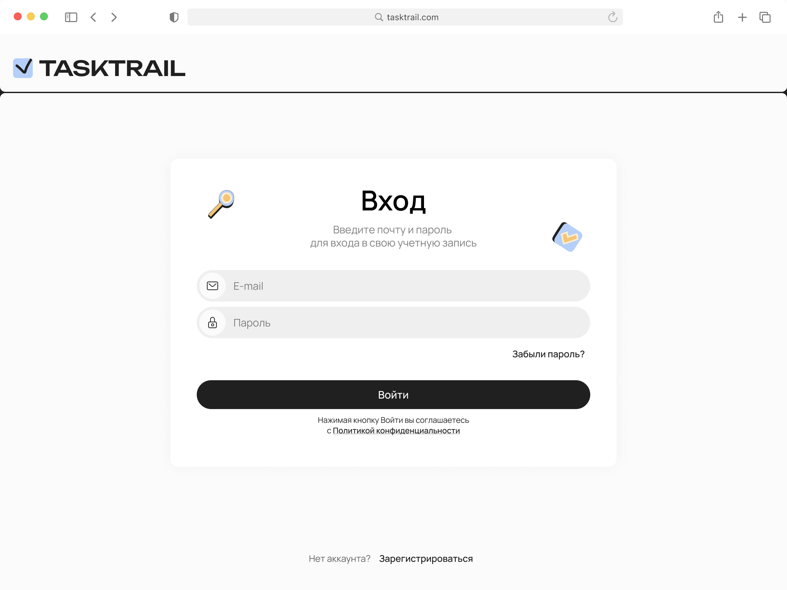
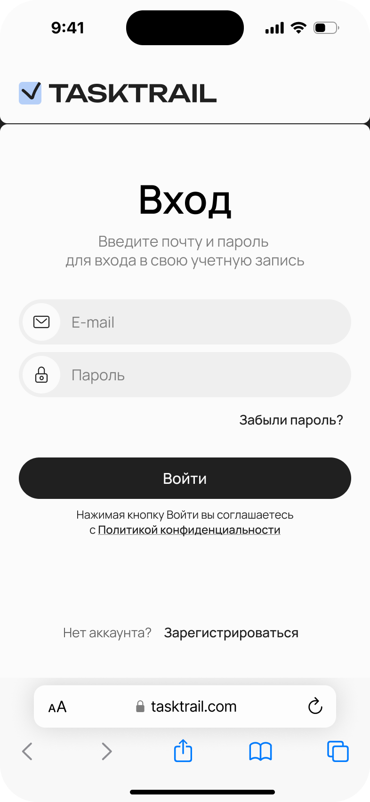

# TaskTrail


---

🚀 **Live Demo:** [https://dev.hiraise.net/tasktrail/](https://dev.hiraise.net/tasktrail/)

---

TaskTrail is a modern, open-source, self-hosted task tracking web application built with **Vite + React** and TypeScript. The project follows a modular, Clean Architecture-inspired structure for scalability, maintainability, and clear separation of concerns.

## Features

- **Authentication**: Complete auth flow (login, signup, password recovery, email confirmation)
- **Project Management**: Create, edit, and manage projects with member permissions
- **Task Management**: Full task lifecycle with assignments, comments, and status tracking
- **Kanban Boards**: Drag-and-drop task boards with customizable columns
- **Global Search**: Search across projects, tasks, and boards
- **User Profiles**: Profile management with avatar upload and image cropping
- **State Management**: Client-side state with Zustand, server-side state with React Query
- **Responsive Design**: Mobile-first, adaptive UI for all screen sizes with dedicated mobile/desktop layouts
- **Localization**: Multi-language support (ru/en) for text and images
- **Reusable Components**: Rich library of UI components, modals, and feature-specific widgets
- **Form Management**: Type-safe forms with React Hook Form and Zod validation
- **Drag & Drop**: Advanced drag-and-drop functionality with @dnd-kit
- **Animations**: Smooth animations and transitions with Framer Motion
- **Centralized Error Handling**: Global and local error management
- **Clean Architecture**: Clear separation of concerns with domain, application, infrastructure, and presentation layers

## ✨ Features

### Login Page

Here's a sneak peek of our clean and intuitive login interface, available on both desktop and mobile devices.

|                      Desktop                      |                     Mobile                      |
| :-----------------------------------------------: | :---------------------------------------------: |
|  |  |

## Tech Stack

- **Vite 8** (dev server, bundler)
- **TypeScript 6**
- **React 19**
- **TanStack Router** (file-based routing with auto code splitting)
- **TanStack Query** (server-side state management)
- **Zustand** (client-side state management)
- **CSS Modules** (primary styling approach)
- **Framer Motion** (animations)
- **React Hook Form** + **Zod** (form management and validation)
- **@dnd-kit** (drag-and-drop functionality)
- **Sonner** (toast notifications)
- **Axios** (HTTP requests)
- **@floating-ui/react** (floating elements positioning)
- **date-fns** (date formatting)
- **ESLint** + **Prettier** (code quality)

## Project Structure

```
src/
├── routes/                  # TanStack Router file-based routes
│   ├── __root.tsx           # Root layout
│   ├── _main.tsx            # Authenticated layout
│   ├── auth.tsx             # Auth layout
│   ├── _main/               # Main application routes
│   │   ├── boards/          # Kanban boards
│   │   ├── projects/        # Project management
│   │   ├── tasks/           # Task management
│   │   ├── profile/         # User profile
│   │   └── search/          # Global search
│   └── auth/                # Authentication pages (login, signup, etc.)
├── application/             # Application-level logic (use cases)
│   ├── dto/                 # Data Transfer Objects
│   ├── payloads/            # Request/Response payloads
│   └── usecases/            # Business use cases
│       ├── auth/
│       ├── project/
│       ├── projectMember/
│       ├── task/
│       └── user/
├── domain/                  # Core business logic and entities
│   ├── models/              # Domain models
│   ├── repositories/        # Repository interfaces
│   └── types/               # Domain types
├── infrastructure/          # External integrations
│   ├── config/              # Configuration (API routes, logger)
│   ├── http/                # HTTP clients (Axios)
│   └── repositories/        # Repository implementations
├── presentation/            # UI layer
│   ├── app/                 # App-level components and providers
│   ├── features/            # Feature-specific components
│   │   ├── auth/
│   │   ├── boards/
│   │   ├── projects/
│   │   ├── tasks/
│   │   └── user/
│   └── shared/              # Shared presentation components
│       ├── components/      # Reusable components
│       ├── ui/              # Base UI components
│       ├── modals/          # Modal dialogs
│       └── hooks/           # Custom React hooks
└── shared/                  # Shared utilities across layers
    ├── config/
    ├── constants/
    ├── errors/
    ├── locales/
    └── utils/
```

## Getting Started

### Prerequisites

- **Node.js** 22
- **npm** (v10 or higher)

### Installation

The client lives in `web/` of the [TaskTrail repository](https://github.com/hiraise/task-trail).
Install dependencies from `web/`:

```bash
npm ci
```

Repository-wide checks (`scripts/dev.sh`) are described in the [root README](../README.md).

### Running the Development Server

To run the app in development mode, use:

```bash
npm run dev
```

The application will be available at [http://localhost:3000](http://localhost:3000).

> The API address is taken from `VITE_API_URL` at build time (default `http://localhost:8080`).

### Building for Production

```bash
npm run build
```

Output will be in the `dist` directory.

### Preview Production Build

```bash
npm run preview
```

## Development process and roadmap

The project is developed by AI agents under the rules in [CLAUDE.md](../CLAUDE.md); the plan is in
the [root README](../README.md). Boards, comments and search are UI-only for now: they show mock
data until the server provides them.

## License

This project is licensed under the MIT License. See the [LICENSE](../LICENSE) file for details.

## Architecture Overview

TaskTrail uses a modular architecture inspired by Clean Architecture principles to ensure a clean separation of concerns, making the codebase scalable and maintainable.

- **`routes`**: File-based routing powered by TanStack Router. Routes are split into `_main/` (authenticated) and `auth/` sections. Supports auto code splitting and type-safe navigation.
- **`application`**: Contains the application-specific business rules and use cases. It orchestrates the flow of data between the domain and infrastructure layers. Includes DTOs, payloads, and organized use cases by feature (auth, project, task, user).
- **`domain`**: The core of the application, containing the business logic, entities (models), repository interfaces, and domain types. This layer is independent of any framework or external dependency.
- **`infrastructure`**: Implements the interfaces defined in the domain layer, handling external concerns like HTTP communication (Axios client) and repository implementations.
- **`presentation`**: Contains all UI-related code organized into:
  - `app/`: Application-level components and providers
  - `features/`: Feature-specific components organized by domain (auth, boards, projects, tasks, user)
  - `shared/`: Reusable UI components, modals, hooks, and base UI elements
- **`shared`**: A collection of utilities, constants, error definitions, localization files, and other shared code that can be used across all application layers.
